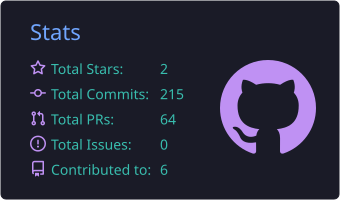
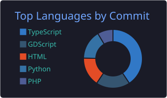

<!-- CABEÇALHO -->

  

  

  
  
  
  

---

## 👋 Sobre mim

Olá! Sou o **Antônio**, desenvolvedor FullStack e estudante de **Análise e Desenvolvimento de Sistemas na UNIFIP**.

Gosto de transformar ideias em aplicações web **modernas, responsivas e escaláveis**, cuidando tanto da interface quanto da lógica por trás dela.

- 🔭 Atualmente focado em **Next.js** e **Django**
- 🎮 Já desenvolvi jogos 2D com **Godot** (GDScript) em projetos acadêmicos
- 🌱 Estudando arquitetura de software e integração de APIs
- 💬 Pergunte-me sobre: desenvolvimento web, lógica de programação e game dev

---

## 🛠️ Tecnologias

**Front-end**

  

**Back-end**

  

**Banco de dados, ferramentas e game dev**

  

---

## 📌 Projetos em destaque

<!-- Substitua pelos seus projetos reais -->

| Projeto | Descrição | Tecnologias |
|---------|-----------|-------------|
| [**Nome do projeto 1**](https://github.com/Antonio-Felix/REPO1) | Uma frase sobre o que ele faz e o problema que resolve | Next.js, Tailwind |
| [**Nome do projeto 2**](https://github.com/Antonio-Felix/REPO2) | Uma frase sobre o que ele faz e o problema que resolve | Django, MySQL |
| [**Nome do projeto 3**](https://github.com/Antonio-Felix/REPO3) | Jogo 2D desenvolvido em projeto acadêmico | Godot, GDScript |

---

## 🧠 Em estudo

- ⚡ Next.js avançado (SSR, SSG, API Routes)
- 🧩 Arquitetura de software
- 🔗 Integração de APIs
- 🐍 Backend com Django

---

## 📊 Estatísticas no GitHub

  
  

---

## 🤝 Vamos conversar?

Estou aberto a oportunidades, projetos e trocas de conhecimento. Se curtiu algo por aqui, fique à vontade para entrar em contato!

  

